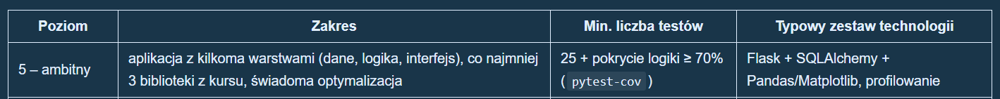

# Тема проекта створення сайта з якістю повітря в Польщі

## Вимоги до проекта 

## Корисні посилання 

Ось посилання на api gios:
https://powietrze.gios.gov.pl/pjp/content/api

А ось посилання на сам сайт:
https://powietrze.gios.gov.pl/pjp/current!

## Про проект
Парсер буде написаний на python і вже реаалізований в parser.py

## Файли

### parser.py
В файлі parser.py є кілька класів:\
Data \
BaseParser \
StationsParser \
SensorParser \
GiosParser 

Data - клас для збереження інформації станції і її сенсорів \ 

BaseParser - абстракний клас парсера від якого походять інші парсери \

StationsParser - парсер станцій, він знаходить всі станції, які доступні. А також наслідується від BaseParser \ 

SensorParser - для вибраної станції по її id знаходить її сенсори. А також наслідується від BaseParser \

GiosParser - Поєднання всіх класів вище крім BaseParser, він знаходить за допомогою них всі станції і для кожної станції її сенсори, і потім зберігає їх в списку з Data обєктами 
