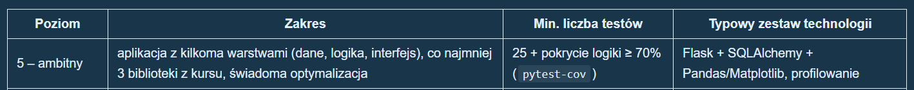

# Тема проекта створення сайта з якістю повітря в Польщі


## Вимоги до проекта 



## Корисні посилання 

Ось посилання на api gios:
https://powietrze.gios.gov.pl/pjp/content/api

А ось посилання на сам сайт:
https://powietrze.gios.gov.pl/pjp/current!


## Про проект
Парсер буде написаний на python і вже реаалізований в parser.py


## Файли

### Структура проєкту

```text
D:.
|   .gitignore
|   README.md
|            
+---app
|   |   app.py
|   |   __init__.py
|   |   
|   +---data
|   |       .gitkeep
|   |       data.json
|   |       
|   +---normalizers
|   |       DataNormalizer.py
|   |       __init__.py
|   |       
|   \---parsers
|       |   Data.py
|       |   GiosParser.py
|       |   Parsers.py
|       |   __init__.py
|               
+---docs
|       wymagania.png

PS: tree /f /a
```

Асинхронний парсер розділений на модулі в директорії `app/parsers/` та містить такі файли і класи:

### `Data.py`
* **`Data`** — клас для збереження метаданих вимірювальної станції (назва, ID, повіт, воєводство, координати), її сенсорів та офіційного індексу якості повітря GIOŚ (`overall_index`, індекси окремих показників) з можливістю серіалізації у словник (`to_dict()`).

### `Parsers.py`
* **`BaseParser`** — базовий абстрактний асинхронний клас парсера, від якого наслідуються інші парсери. Ініціалізує базовий URL API та виконує асинхронні GET-запити через `aiohttp` з підтримкою обмеження паралельних запитів (`asyncio.Semaphore`).
* **`StationsParser`** — наслідується від `BaseParser`. Завантажує список усіх доступних вимірювальних станцій з урахуванням пагінації API та нормалізує їхні поля і координати.
* **`SensorParser`** — наслідується від `BaseParser`. Для вибраної станції за її `station_id` отримує всі сенсори, асинхронно завантажує їхні останні вимірювання та перевіряє актуальність даних за часом у Польщі (`is_stale`).
* **`IndexParser`** — наслідується від `BaseParser`. Завантажує офіційний загальний індекс якості повітря для станції та категорії індексу для окремих забруднювачів (`PM10`, `PM2.5`, `O3`, `NO2`, `SO2`).

### `GiosParser.py`
* **`GiosParser`** — головний клас-оркестратор, який об'єднує `StationsParser`, `SensorParser` та `IndexParser`. Асинхронно завантажує дані по всіх станціях або по вибраному воєводству (`fetch_all()`, `fetch_voivodeship()`), формує об'єкти `Data` та групує їх у словник за воєводствами.


### Теги завдань:
https://trello.com/b/C1yehgVn